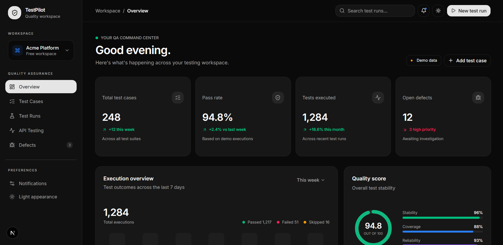
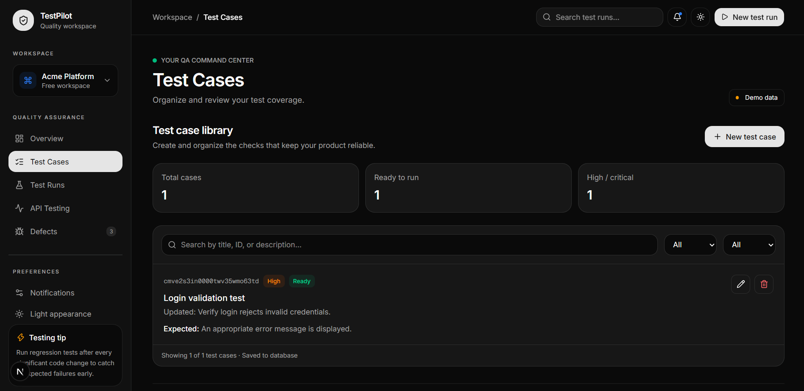
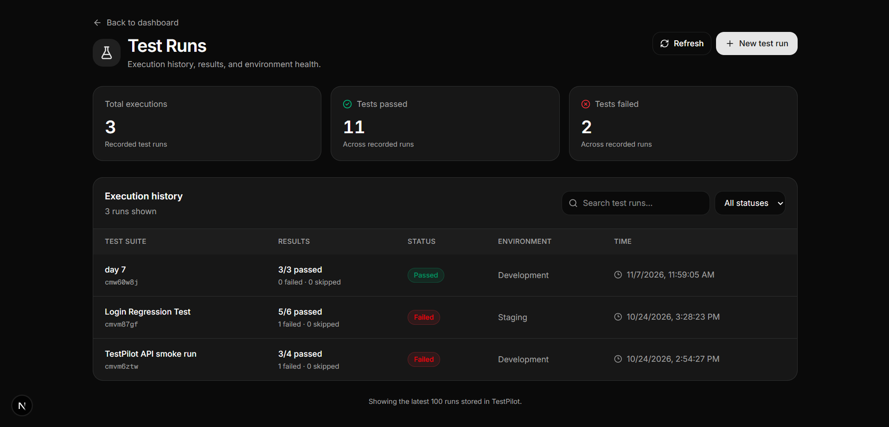
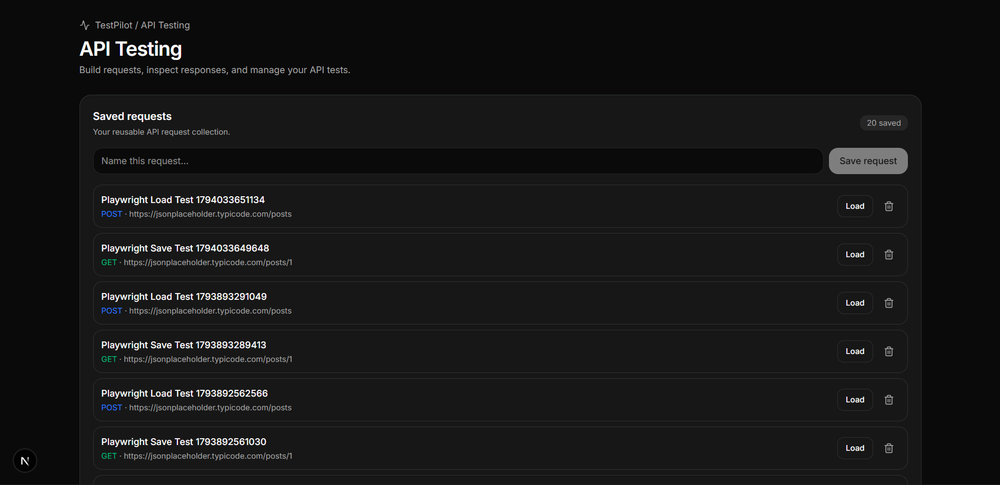
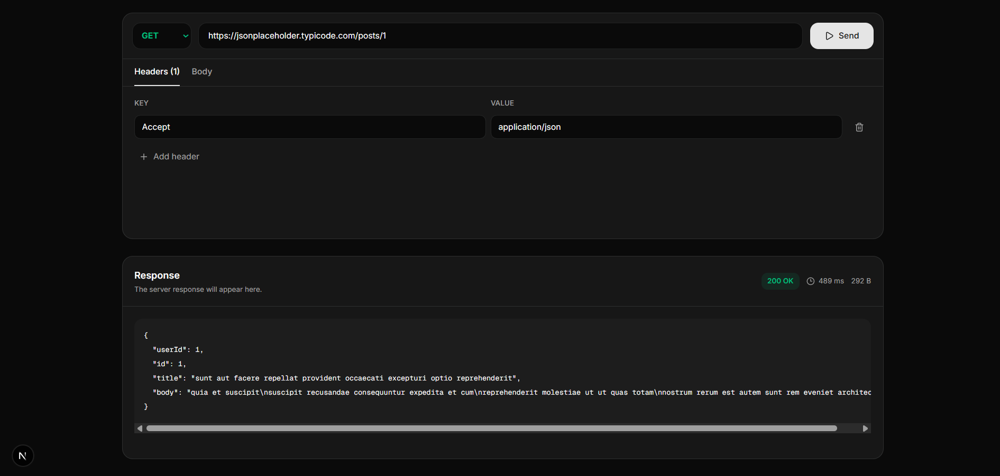
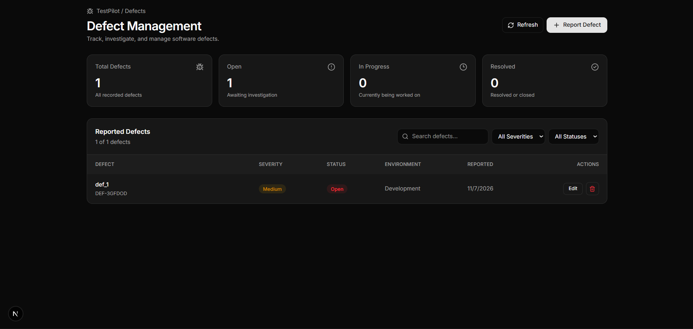

# TestPilot

**A QA Engineering Dashboard for Test Case Management, Test Execution, API Testing, and Defect Tracking.**

TestPilot is a QA engineering portfolio project I'm building to bring different software testing activities into one place. It provides a centralized interface to manage test cases, organize test runs, execute API requests, and track defects.

I wanted to build something that goes beyond a basic testing dashboard and demonstrates how different parts of a QA workflow can work together, from writing test cases to recording defects and validating application behavior.

## Features

### 1. Dashboard
- Centralized overview of testing activities.
- Summary of test cases, test runs, and defects.
- Navigation across the application's modules.
- Light and dark themes.

### 2. Test Case Management
- Create, edit, and delete test cases.
- Record test descriptions, execution steps, and expected results.
- Assign priorities: Low, Medium, High, and Critical.
- Track statuses: Draft, Ready, and Blocked.
- Search and filter test cases.
- Persistent database-backed storage.

### 3. Test Run Management
- Create and manage test runs.
- Record the testing environment.
- Track passed, failed, and skipped test counts.
- Maintain execution status and timestamps.
- Associate defects with relevant test runs.

### 4. API Testing
- Manage saved API requests.
- Work with HTTP methods, URLs, headers, and request bodies.
- Execute API requests through the backend.
- Inspect API responses and validate request behavior.

### 5. Defect Management
- Create, edit, and delete defects.
- Record descriptions and reproduction steps.
- Document expected and actual results.
- Assign severity and status.
- Associate defects with test cases and test runs.
- Search and filter defect records.

## Tech Stack

| Category | Technology |
|---|---|
| Frontend | Next.js 16, React 19, TypeScript |
| Styling | Tailwind CSS 4, shadcn/ui |
| Backend | Next.js Route Handlers |
| Database | SQLite |
| ORM | Prisma 7 |
| Database Adapter | better-sqlite3 |
| Automated Testing | Playwright |
| Code Quality | ESLint |
| Package Manager | pnpm |

## Architecture

TestPilot uses a Next.js application structure with frontend pages, backend API routes, and a database layer.

- **Frontend:** React components provide the dashboard and individual testing modules.
- **Backend:** Next.js Route Handlers process API requests and perform application operations.
- **Database:** SQLite stores application data.
- **ORM:** Prisma manages database models and database operations.
- **Testing:** Playwright automates browser-based tests to verify important application workflows.

### Database Models

The Prisma schema currently contains four primary models:

| Model | Purpose |
|---|---|
| `TestCase` | Stores test case details, steps, priority, and status. |
| `TestRun` | Stores execution information, environment, and test results. |
| `Defect` | Stores defect details, severity, status, and relationships. |
| `ApiRequest` | Stores API request configurations. |

Defects can optionally be linked to test cases and test runs. If a linked record is deleted, the relationship is set to null rather than deleting the defect.

## API Routes

The application exposes the following backend routes:

| Endpoint | Purpose |
|---|---|
| `GET /api/test-cases` | Retrieve test cases |
| `POST /api/test-cases` | Create a test case |
| `PATCH /api/test-cases/:id` | Update a test case |
| `DELETE /api/test-cases/:id` | Delete a test case |
| `/api/test-runs` | Test run management |
| `/api/defects` | Defect collection management |
| `/api/defects/:id` | Individual defect operations |
| `/api/api-requests` | Saved API request management |
| `/api/api-requests/:id` | Individual API request operations |
| `POST /api/api-testing/execute` | Execute an API request |

The API routes are implemented using Next.js Route Handlers.

## Automated Testing

I use Playwright to automate important application workflows and catch regressions while developing TestPilot.

The current automated test suite contains **41 passing tests** across seven test files.

| Test Area | Tests Passed |
|---|---:|
| API Request Validation | 13 |
| API Testing Interface | 7 |
| Data Integrity | 3 |
| Defect Management | 5 |
| Dashboard | 3 |
| Test Cases | 4 |
| Test Runs | 6 |
| **Total** | **41/41** |

### Running the Tests

Start the development server in one terminal:

```bash
pnpm dev
```

In a second terminal, execute:

```bash
pnpm exec playwright test --workers=1
```

The Playwright suite includes both interface-level tests and API validation tests. Some frontend workflows use mocked API responses, so the test count should not be interpreted as 41 independent database integration tests.

### Code Quality and Production Build

Run ESLint:

```bash
pnpm lint
```

Create a production build:

```bash
pnpm build
```

Both checks currently pass.

## Getting Started

### Prerequisites

- Node.js
- pnpm
- Git

### 1. Clone the repository

```bash
git clone https://github.com/RishiSelam/TestPilot.git
cd TestPilot
```

### 2. Install dependencies

```bash
pnpm install
```

### 3. Configure environment variables

Create a `.env` file in the project root:

```env
DATABASE_URL="file:./dev.db"
```

### 4. Set up the database

Apply the existing Prisma migrations:

```bash
pnpm exec prisma migrate deploy
```

Generate the Prisma client:

```bash
pnpm exec prisma generate
```

### 5. Start the development server

```bash
pnpm dev
```

Open [http://localhost:3000](http://localhost:3000) in your browser.

## Project Structure

```text
TestPilot/
│
├── app/
│   ├── api/
│   │   ├── api-requests/
│   │   ├── api-testing/
│   │   ├── defects/
│   │   ├── test-cases/
│   │   └── test-runs/
│   │
│   ├── api-testing/
│   ├── defects/
│   ├── test-runs/
│   └── page.tsx
│
├── components/
│   ├── defects-view.tsx
│   ├── test-cases-view.tsx
│   └── ...
│
├── lib/
│   └── prisma.ts
│
├── prisma/
│   ├── migrations/
│   └── schema.prisma
│
├── tests/
│   ├── api-testing-validation.spec.ts
│   ├── api-testing.spec.ts
│   ├── data-integrity.spec.ts
│   ├── defects.spec.ts
│   ├── smoke.spec.ts
│   ├── test-cases.spec.ts
│   └── test-runs.spec.ts
│
├── package.json
└── README.md
```

## Screenshots

Screenshots of the application will be added here as the project documentation is finalized.

| Module | Preview |
|---|---|
| Dashboard | Coming soon |
| Test Cases | Coming soon |
| Test Runs | Coming soon |
| API Testing | Coming soon |
| Defects | Coming soon |

## Current Development Status

The core application modules, database-backed operations, API functionality, and automated testing suite have been implemented.

I'm currently focusing on final verification, documentation, and preparing the application for deployment.

Planned improvements include:

- Migrating the database from SQLite to PostgreSQL for production.
- Deploying the application using Render and Neon.
- Performing production-level smoke testing.

## Screenshots

### Dashboard


### Test Cases


### Test Runs


### API Testing


### API Testing - Additional View


### Defect Management


## Useful Resources

- [Next.js Documentation](https://nextjs.org/docs)
- [TypeScript Documentation](https://www.typescriptlang.org/docs/)
- [Prisma Documentation](https://www.prisma.io/docs)
- [Playwright Documentation](https://playwright.dev/docs/intro)
- [Tailwind CSS Documentation](https://tailwindcss.com/docs)

## Repository

**GitHub:** [RishiSelam/TestPilot](https://github.com/RishiSelam/TestPilot)

---

*Built as a hands-on QA engineering portfolio project.*